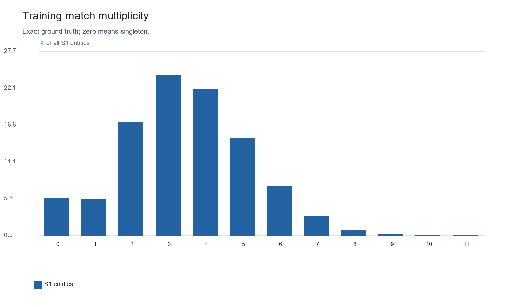
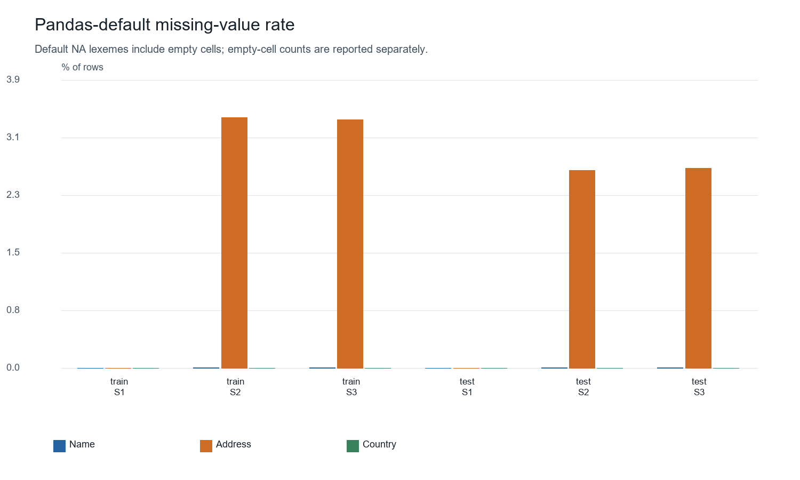
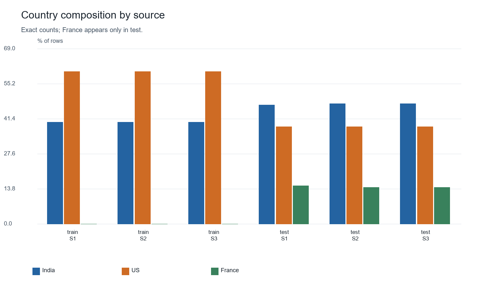
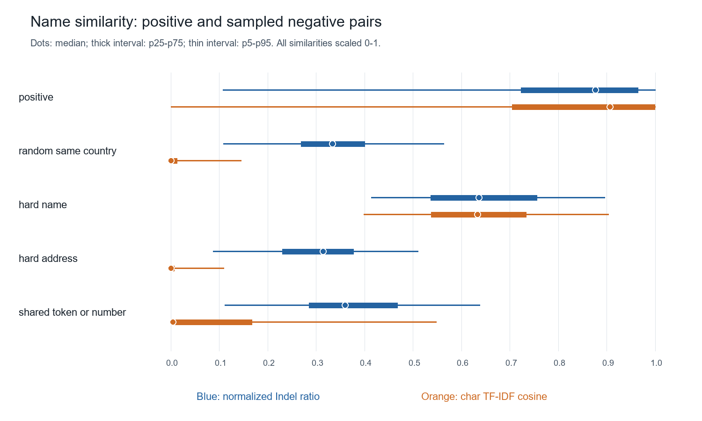
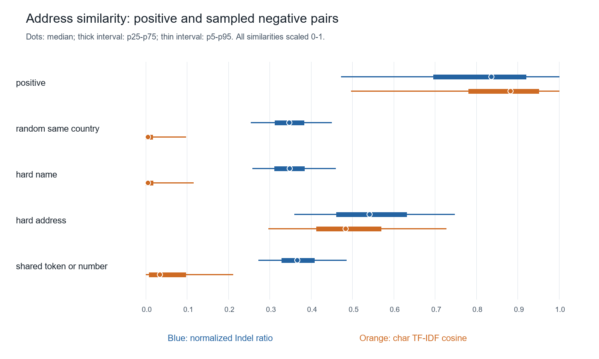
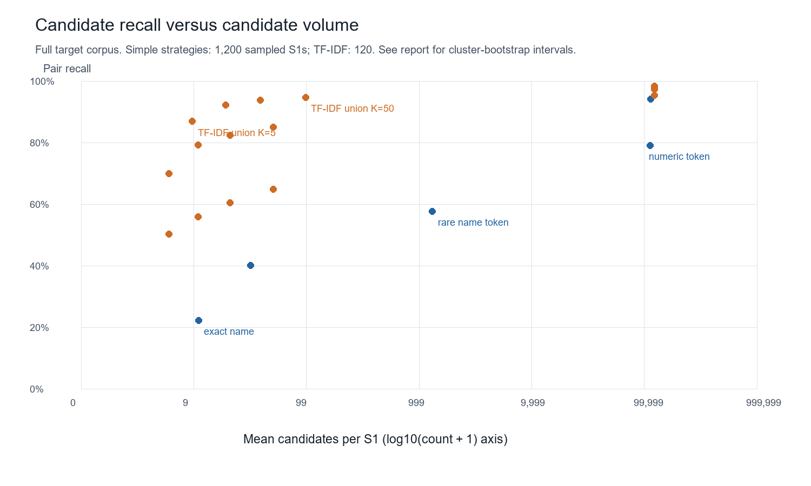

# Amazon ML Challenge 2026 — Dataset analysis

## Executive summary

The six source files contain **24,229,173 records**. Training ground truth represents **2,206,821 Source 1 entities** and **7,638,365 labeled pairs**. **5.58%** of reference entities are singletons. The observed relation is one-to-many from S1, with uniquely assigned target records.

On the 1,200-entity diagnostic sample, name raw equality is 4.80%; normalized equality is 22.28%. Address raw equality is 2.09%; normalized equality is 8.30%. These are sampled pair-weighted statistics, not population claims. No classifier, semantic embedding, final blocker, or submission was built.

## Scope, methods, and reproducibility

Only the seven official TSV files were read as data. The supplied local README was used to interpret labels and scoring. Original files were not edited; SHA-256 fingerprints are stored in JSON. Source reads use `pd.read_csv(path, sep="\t", chunksize=50000, dtype=str, keep_default_na=False)` to preserve raw empty cells and NA-like strings. Default pandas NA membership is counted separately; a default-parser first-1,000-row read records inferred dtypes. TSV has no intrinsic type system: all four source fields are strings. A strict independent CSV pass checks widths and record counts. Disk-backed SQLite stores raw records and simple diagnostic forms; no full set of source files is resident in RAM. Per-country length/token histograms, missingness, uniqueness, duplicates and truth validation are exact. Pair signals use a reproducible proportional country-stratified S1 sample. Every true target of each sampled S1 is retained; standard errors therefore cluster by S1. Hard negatives are sampled-corpus examples, so their error rates do not estimate production precision. Full-universe blocking probes search all same-country training S2 and S3 records. TF-IDF vocabulary and IDF use a uniform training target sample; this remains an exploratory lexical diagnostic. Country gating is evaluated against cross-country truth, including excluded matches in the recall denominator.

Seed: `20260925`. Similarity backend: **Python exact normalized-Indel/token formulas; RapidFuzz package unavailable offline**. The fallback implements exact normalized Indel, token-sort, token-set and unit-cost Levenshtein formulas; it is not a call to the unavailable RapidFuzz package. The included independent method check compares both distances against dynamic programming on 500 random string pairs.

Reproduce: `python analysis/run_eda.py --data-root dataset-20260925T050739Z-1-001/dataset`. Dependencies and the exact locally used command are in `analysis/README.md`. Cache fingerprints include input sizes/mtime and configuration; remove only `analysis/cache/` for a clean run. No network access or dependency download is required. Similarities run in [0,1]. Undefined numeric/postal comparisons remain missing, never disguised as disagreement or agreement.

## Dataset dimensions and integrity

| File | MB (decimal) | Rows | Unique IDs | Duplicate ID excess | Bad prefixes/syntax | Duplicate full-row excess |
| --- | --- | --- | --- | --- | --- | --- |
| train_source1 | 210.070 | 2,206,821 | 2,206,821 | 0 | 0 | 0 |
| train_source2 | 489.301 | 5,034,616 | 5,034,616 | 0 | 0 | 0 |
| train_source3 | 503.706 | 5,285,603 | 5,285,603 | 0 | 0 | 0 |
| test_source1 | 175.022 | 1,732,544 | 1,732,544 | 0 | 0 | 0 |
| test_source2 | 509.456 | 4,887,273 | 4,887,273 | 0 | 0 | 0 |
| test_source3 | 506.003 | 5,082,316 | 5,082,316 | 0 | 0 | 0 |
| train_ground_truth | 127.016 | 2,206,821 | 2,206,821 | 0 | 0 | see GT checks |

All source schemas: `entity_id, business_name, business_address, country`; ground truth: `source1_entity_id, matched_entity_ids`. Per-file inferred and loaded dtypes, strict parser results, and hashes are in JSON. Unexpected country labels: {"train_source1": [], "train_source2": [], "train_source3": [], "test_source1": [], "test_source2": [], "test_source3": []}.

## Ground-truth structure and singleton statistics

| Matches per S1 | S1 count | % of S1 |
| --- | --- | --- |
| 0 | 123,247 | 5.585 |
| 1 | 119,157 | 5.399 |
| 2 | 375,212 | 17.002 |
| 3+ | 1,589,205 | 72.013 |

| Statistic | Value |
| --- | --- |
| Mean matches | 3.461 |
| Median matches | 3.000 |
| Maximum matches | 11 |
| S2 only | 143,029 |
| S3 only | 164,498 |
| Both S2 and S3 | 1,776,047 |
| Unique referenced targets | 7,638,365 |
| Targets assigned to multiple S1s | 0 |
| S1 missing truth rows | 0 |
| Invalid S1 references | 0 |
| Invalid S2 references | 0 |
| Invalid S3 references | 0 |
| Duplicate IDs inside lists | 0 |
| Malformed lists | 0 |
| Invalid target syntax | 0 |
| Cross-country positive pairs | 0 |

| Country | S1 | Singletons | Singleton % | Pairs |
| --- | --- | --- | --- | --- |
| India | 883,188 | 49,351 | 5.588 | 3,059,843 |
| US | 1,323,633 | 73,896 | 5.583 | 4,578,522 |

The metric gives a correct empty prediction full credit for a singleton and any false match zero credit. Pair prevalence therefore cannot replace an entity-level analysis.

## Missingness and empty cells

| File | Column | Pandas-null count | Null % | Literal empty count | Nonempty NA lexemes | Whitespace-only |
| --- | --- | --- | --- | --- | --- | --- |
| train_source1 | entity_id | 0 | 0.000 | 0 | 0 | 0 |
| train_source1 | business_name | 0 | 0.000 | 0 | 0 | 0 |
| train_source1 | business_address | 0 | 0.000 | 0 | 0 | 0 |
| train_source1 | country | 0 | 0.000 | 0 | 0 | 0 |
| train_source2 | entity_id | 0 | 0.000 | 0 | 0 | 0 |
| train_source2 | business_name | 2 | 0.000 | 0 | 2 | 0 |
| train_source2 | business_address | 168,967 | 3.356 | 168,967 | 0 | 0 |
| train_source2 | country | 0 | 0.000 | 0 | 0 | 0 |
| train_source3 | entity_id | 0 | 0.000 | 0 | 0 | 0 |
| train_source3 | business_name | 13 | 0.000 | 0 | 13 | 0 |
| train_source3 | business_address | 175,916 | 3.328 | 175,916 | 0 | 0 |
| train_source3 | country | 0 | 0.000 | 0 | 0 | 0 |
| test_source1 | entity_id | 0 | 0.000 | 0 | 0 | 0 |
| test_source1 | business_name | 0 | 0.000 | 0 | 0 | 0 |
| test_source1 | business_address | 0 | 0.000 | 0 | 0 | 0 |
| test_source1 | country | 0 | 0.000 | 0 | 0 | 0 |
| test_source2 | entity_id | 0 | 0.000 | 0 | 0 | 0 |
| test_source2 | business_name | 46 | 0.001 | 0 | 46 | 0 |
| test_source2 | business_address | 129,408 | 2.648 | 129,408 | 0 | 0 |
| test_source2 | country | 0 | 0.000 | 0 | 0 | 0 |
| test_source3 | entity_id | 0 | 0.000 | 0 | 0 | 0 |
| test_source3 | business_name | 59 | 0.001 | 0 | 59 | 0 |
| test_source3 | business_address | 136,098 | 2.678 | 136,098 | 0 | 0 |
| test_source3 | country | 0 | 0.000 | 0 | 0 | 0 |

Pandas-null counts include empty strings by default. Empty strings are also reported separately, so these columns must not be summed. Only non-null field values contribute to length/token summaries. Whitespace-only strings are counted separately from zero-length fields. Ground truth has 123,247 literal empty match lists; these are valid singleton labels.

## Field quality by source

| File | Name mean chars | Name median chars | Name median tokens | Name p95 tokens | Unique nonempty names | Address mean chars | Address median tokens | Unique address / all rows | Any digits rate | 5/6-digit token rate |
| --- | --- | --- | --- | --- | --- | --- | --- | --- | --- | --- |
| train_source1 | 24.034 | 24.000 | 4.000 | 5.000 | 1,539,229 | 52.066 | 7.000 | 0.965 | 0.965 | 0.067 |
| train_source2 | 25.104 | 25.000 | 4.000 | 5.000 | 4,402,009 | 47.831 | 6.000 | 0.861 | 0.938 | 0.076 |
| train_source3 | 25.202 | 25.000 | 4.000 | 6.000 | 4,651,609 | 48.323 | 6.000 | 0.876 | 0.939 | 0.075 |
| test_source1 | 23.836 | 24.000 | 4.000 | 5.000 | 1,238,867 | 57.213 | 8.000 | 0.968 | 0.959 | 0.044 |
| test_source2 | 25.704 | 25.000 | 4.000 | 5.000 | 4,311,041 | 51.785 | 7.000 | 0.864 | 0.952 | 0.052 |
| test_source3 | 25.655 | 25.000 | 4.000 | 6.000 | 4,521,929 | 50.082 | 7.000 | 0.877 | 0.950 | 0.052 |

Token counts use whitespace on raw strings. Numeric tokens are contiguous Unicode digits; postal-like tokens are standalone 5–6 digits with word boundaries. These are generic shapes, not validated postal codes; street/building numbers can be mistaken for postal-like numbers. Full token-count, character, and numeric-count distributions are retained in JSON.

## Country mix and repeated names

| File | Country | Rows | Country % | Rows in repeated raw names | Rows in repeated normalized names | Unique address ratio |
| --- | --- | --- | --- | --- | --- | --- |
| train_source1 | India | 883,188 | 40.021 | 0.438 | 0.444 | 0.970 |
| train_source1 | US | 1,323,633 | 59.979 | 0.346 | 0.358 | 0.963 |
| train_source2 | India | 2,017,799 | 40.079 | 0.219 | 0.296 | 0.871 |
| train_source2 | US | 3,016,817 | 59.921 | 0.141 | 0.266 | 0.855 |
| train_source3 | India | 2,115,547 | 40.025 | 0.189 | 0.268 | 0.897 |
| train_source3 | US | 3,170,056 | 59.975 | 0.154 | 0.262 | 0.863 |
| test_source1 | France | 259,452 | 14.975 | 0.339 | 0.341 | 0.943 |
| test_source1 | India | 809,986 | 46.751 | 0.432 | 0.438 | 0.971 |
| test_source1 | US | 663,106 | 38.274 | 0.280 | 0.291 | 0.975 |
| test_source2 | France | 703,378 | 14.392 | 0.176 | 0.306 | 0.853 |
| test_source2 | India | 2,312,565 | 47.318 | 0.203 | 0.268 | 0.874 |
| test_source2 | US | 1,871,330 | 38.290 | 0.108 | 0.213 | 0.857 |
| test_source3 | France | 731,615 | 14.395 | 0.194 | 0.307 | 0.837 |
| test_source3 | India | 2,405,000 | 47.321 | 0.174 | 0.243 | 0.900 |
| test_source3 | US | 1,945,701 | 38.284 | 0.118 | 0.211 | 0.863 |

Repeated-name rates count every row in a value group of size >1, not just the excess duplicates. Source 1 entity deduplication does not imply name uniqueness. Repeated names may describe chains or unrelated generic names; names alone cannot establish which.

**train_source1 / India:** `shree trading private limited` (99); `shree brothers private limited` (97); `mumbai india private limited` (96); `new delhi india private limited` (94); `shree co` (94)

**train_source1 / US:** `primary care group` (253); `ear nose throat group` (251); `pediatric group` (222); `womens health group` (220); `physical therapy group` (218)

**train_source2 / India:** `new delhi` (128); `र यल आईट प र इव ट ल म ट ड` (72); `लक ष म क सल ट स प र इव ट ल म ट ड` (68); `लक ष म ब जन स प र इव ट ल म ट ड` (67); `श व इ डस ट र ज प र इव ट ल म ट ड` (67)

**train_source2 / US:** `physical therapy` (526); `primary care` (518); `womens health` (483); `urgent care` (469); `behavioral health` (468)

**train_source3 / India:** `india` (183); `sc` (182); `si` (175); `shree` (166); `ss` (160)

**train_source3 / US:** `primary care` (521); `physical therapy` (516); `pediatric dental` (503); `urgent care` (480); `womens health` (469)

**test_source1 / France:** `bordeaux club sarl` (205); `nantes club sarl` (157); `lille club sarl` (147); `lille club sas` (122); `bordeaux club sas` (118)

**test_source1 / India:** `new delhi india private limited` (98); `shree co` (97); `shree brothers private limited` (82); `mumbai india private limited` (76); `shree trading private limited` (71)

**test_source1 / US:** `urgent care group` (123); `ear nose throat group` (112); `internal medicine group` (111); `pediatric dental group` (110); `eye group` (109)

**test_source2 / France:** `cc` (300); `bordeaux club` (220); `nantes club` (208); `lille club` (200); `pc` (196)

**test_source2 / India:** `new delhi` (142); `श र फ उ ड शन प र इव ट ल म ट ड` (69); `जय एनर ज प र इव ट ल म ट ड` (68); `जय ह स प ट ल ट प र इव ट ल म ट ड` (68); `र यल एनर ज प र इव ट ल म ट ड` (65)

**test_source2 / US:** `urgent care` (265); `primary care` (253); `womens health` (251); `behavioral health` (238); `pediatric dentistry` (236)

**test_source3 / France:** `cc` (352); `pc` (243); `ac` (220); `lille club` (220); `nantes club` (220)

**test_source3 / India:** `si` (166); `sc` (159); `india` (157); `services` (145); `st` (144)

**test_source3 / US:** `internal medicine` (269); `urgent care` (264); `pediatric dentistry` (251); `primary care` (250); `behavioral health` (230)

## Positive-match and hard-negative similarity patterns

| Pair stratum | Signal | Valid N | Mean | p5 | p50 | p95 |
| --- | --- | --- | --- | --- | --- | --- |
| hard_address | name_raw_equal | 3,600 | 0.000 | 0.000 | 0.000 | 0.000 |
| hard_address | name_normalized_equal | 3,600 | 0.000 | 0.000 | 0.000 | 0.000 |
| hard_address | name_suffix_equal | 3,600 | 0.000 | 0.000 | 0.000 | 0.000 |
| hard_address | name_ratio | 3,600 | 0.302 | 0.087 | 0.314 | 0.511 |
| hard_address | name_token_set_ratio | 3,600 | 0.311 | 0.100 | 0.316 | 0.552 |
| hard_address | name_tfidf_cosine | 3,600 | 0.019 | 0.000 | 0.000 | 0.109 |
| hard_address | address_raw_equal | 3,600 | 0.000 | 0.000 | 0.000 | 0.000 |
| hard_address | address_normalized_equal | 3,600 | 0.000 | 0.000 | 0.000 | 0.000 |
| hard_address | address_ratio | 3,600 | 0.547 | 0.360 | 0.542 | 0.747 |
| hard_address | address_tfidf_cosine | 3,600 | 0.495 | 0.297 | 0.484 | 0.727 |
| hard_address | address_numeric_overlap | 3,199 | 0.025 | 0.000 | 0.000 | 0.205 |
| hard_address | address_postal_equal | 63 | 0.048 | 0.000 | 0.000 | 0.000 |
| hard_name | name_raw_equal | 3,600 | 0.004 | 0.000 | 0.000 | 0.000 |
| hard_name | name_normalized_equal | 3,600 | 0.010 | 0.000 | 0.000 | 0.000 |
| hard_name | name_suffix_equal | 3,600 | 0.030 | 0.000 | 0.000 | 0.000 |
| hard_name | name_ratio | 3,600 | 0.646 | 0.414 | 0.636 | 0.897 |
| hard_name | name_token_set_ratio | 3,600 | 0.780 | 0.520 | 0.800 | 1.000 |
| hard_name | name_tfidf_cosine | 3,600 | 0.637 | 0.399 | 0.634 | 0.904 |
| hard_name | address_raw_equal | 3,600 | 0.000 | 0.000 | 0.000 | 0.000 |
| hard_name | address_normalized_equal | 3,600 | 0.000 | 0.000 | 0.000 | 0.000 |
| hard_name | address_ratio | 3,478 | 0.350 | 0.258 | 0.348 | 0.459 |
| hard_name | address_tfidf_cosine | 3,478 | 0.025 | 0.000 | 0.005 | 0.116 |
| hard_name | address_numeric_overlap | 3,142 | 0.008 | 0.000 | 0.000 | 0.000 |
| hard_name | address_postal_equal | 29 | 0.000 | 0.000 | 0.000 | 0.000 |
| positive | name_raw_equal | 4,121 | 0.048 | 0.000 | 0.000 | 0.000 |
| positive | name_normalized_equal | 4,121 | 0.223 | 0.000 | 0.000 | 1.000 |
| positive | name_suffix_equal | 4,121 | 0.401 | 0.000 | 0.000 | 1.000 |
| positive | name_ratio | 4,121 | 0.791 | 0.108 | 0.877 | 1.000 |
| positive | name_token_set_ratio | 4,121 | 0.859 | 0.120 | 1.000 | 1.000 |
| positive | name_tfidf_cosine | 4,121 | 0.783 | 0.000 | 0.907 | 1.000 |
| positive | address_raw_equal | 4,121 | 0.021 | 0.000 | 0.000 | 0.000 |
| positive | address_normalized_equal | 4,121 | 0.083 | 0.000 | 0.000 | 1.000 |
| positive | address_ratio | 3,926 | 0.793 | 0.473 | 0.836 | 1.000 |
| positive | address_tfidf_cosine | 3,926 | 0.838 | 0.498 | 0.882 | 1.000 |
| positive | address_numeric_overlap | 3,561 | 0.803 | 0.000 | 1.000 | 1.000 |
| positive | address_postal_equal | 268 | 0.944 | 0.000 | 1.000 | 1.000 |
| random_same_country | name_raw_equal | 4,800 | 0.000 | 0.000 | 0.000 | 0.000 |
| random_same_country | name_normalized_equal | 4,800 | 0.000 | 0.000 | 0.000 | 0.000 |
| random_same_country | name_suffix_equal | 4,800 | 0.000 | 0.000 | 0.000 | 0.000 |
| random_same_country | name_ratio | 4,800 | 0.335 | 0.109 | 0.333 | 0.563 |
| random_same_country | name_token_set_ratio | 4,800 | 0.341 | 0.120 | 0.328 | 0.609 |
| random_same_country | name_tfidf_cosine | 4,800 | 0.024 | 0.000 | 0.000 | 0.145 |
| random_same_country | address_raw_equal | 4,800 | 0.000 | 0.000 | 0.000 | 0.000 |
| random_same_country | address_normalized_equal | 4,800 | 0.000 | 0.000 | 0.000 | 0.000 |
| random_same_country | address_ratio | 4,620 | 0.349 | 0.255 | 0.347 | 0.449 |
| random_same_country | address_tfidf_cosine | 4,620 | 0.019 | 0.000 | 0.005 | 0.097 |
| random_same_country | address_numeric_overlap | 4,208 | 0.008 | 0.000 | 0.000 | 0.000 |
| random_same_country | address_postal_equal | 36 | 0.000 | 0.000 | 0.000 | 0.000 |
| shared_token_or_number | name_raw_equal | 4,338 | 0.000 | 0.000 | 0.000 | 0.000 |
| shared_token_or_number | name_normalized_equal | 4,338 | 0.000 | 0.000 | 0.000 | 0.000 |
| shared_token_or_number | name_suffix_equal | 4,338 | 0.002 | 0.000 | 0.000 | 0.000 |
| shared_token_or_number | name_ratio | 4,338 | 0.376 | 0.111 | 0.360 | 0.638 |
| shared_token_or_number | name_token_set_ratio | 4,338 | 0.399 | 0.122 | 0.364 | 0.714 |
| shared_token_or_number | name_tfidf_cosine | 4,338 | 0.118 | 0.000 | 0.005 | 0.548 |
| shared_token_or_number | address_raw_equal | 4,338 | 0.000 | 0.000 | 0.000 | 0.000 |
| shared_token_or_number | address_normalized_equal | 4,338 | 0.000 | 0.000 | 0.000 | 0.000 |
| shared_token_or_number | address_ratio | 4,305 | 0.371 | 0.273 | 0.366 | 0.486 |
| shared_token_or_number | address_tfidf_cosine | 4,305 | 0.064 | 0.000 | 0.034 | 0.211 |
| shared_token_or_number | address_numeric_overlap | 4,215 | 0.381 | 0.000 | 0.333 | 1.000 |
| shared_token_or_number | address_postal_equal | 34 | 0.206 | 0.000 | 0.000 | 1.000 |

Name and address fuzzy scores use the conservative NFKC/lowercase/alphanumeric-space form. Raw, lowercase and whitespace equality remain distinct diagnostics. The `name_punctuation_equal` signal combines punctuation spacing with NFKC/lowercase; the normalization section separately reports punctuation deletion. Empty/empty equality is never evidence of a match. Reported equality percentiles are binary; their means give equality rates.

## Strongest separating signals

| Negative stratum | Feature | Univariate ROC AUC | Positive valid N | Negative valid N | Positive >=0.9 | Negative >=0.9 |
| --- | --- | --- | --- | --- | --- | --- |
| random_same_country | address_tfidf_cosine | 1.000 | 3,926 | 4,620 | 0.451 | 0.000 |
| random_same_country | address_jaccard | 1.000 | 3,926 | 4,620 | 0.161 | 0.000 |
| random_same_country | address_token_set_ratio | 1.000 | 3,926 | 4,620 | 0.681 | 0.000 |
| random_same_country | address_token_sort_ratio | 0.990 | 3,926 | 4,620 | 0.441 | 0.000 |
| random_same_country | address_ratio | 0.984 | 3,926 | 4,620 | 0.318 | 0.000 |
| random_same_country | address_postal_equal | 0.972 | 268 | 36 | 0.944 | 0.000 |
| hard_name | address_tfidf_cosine | 0.999 | 3,926 | 3,478 | 0.451 | 0.000 |
| hard_name | address_jaccard | 0.999 | 3,926 | 3,478 | 0.161 | 0.000 |
| hard_name | address_token_set_ratio | 0.999 | 3,926 | 3,478 | 0.681 | 0.000 |
| hard_name | address_token_sort_ratio | 0.989 | 3,926 | 3,478 | 0.441 | 0.000 |
| hard_name | address_ratio | 0.983 | 3,926 | 3,478 | 0.318 | 0.000 |
| hard_name | address_postal_equal | 0.972 | 268 | 29 | 0.944 | 0.000 |
| hard_address | address_numeric_overlap | 0.949 | 3,561 | 3,199 | 0.691 | 0.004 |
| hard_address | address_postal_equal | 0.948 | 268 | 63 | 0.944 | 0.048 |
| hard_address | name_tfidf_cosine | 0.940 | 4,121 | 3,600 | 0.508 | 0.000 |
| hard_address | address_jaccard | 0.937 | 3,926 | 3,600 | 0.161 | 0.000 |
| hard_address | address_tfidf_cosine | 0.933 | 3,926 | 3,600 | 0.451 | 0.001 |
| hard_address | address_token_sort_ratio | 0.924 | 3,926 | 3,600 | 0.441 | 0.003 |
| shared_token_or_number | address_tfidf_cosine | 0.999 | 3,926 | 4,305 | 0.451 | 0.000 |
| shared_token_or_number | address_token_set_ratio | 0.999 | 3,926 | 4,305 | 0.681 | 0.000 |
| shared_token_or_number | address_jaccard | 0.997 | 3,926 | 4,305 | 0.161 | 0.000 |
| shared_token_or_number | address_token_sort_ratio | 0.986 | 3,926 | 4,305 | 0.441 | 0.000 |
| shared_token_or_number | address_ratio | 0.978 | 3,926 | 4,305 | 0.318 | 0.000 |
| shared_token_or_number | address_levenshtein | 0.930 | 3,926 | 4,305 | 0.181 | 0.000 |

AUC here is only a descriptive ranking of one signal at a time; no model was trained. Easy random negatives inflate separation. Hard-name and hard-address comparisons deliberately stress the corresponding field. Sample construction and missing-feature denominators differ by stratum; do not interpret AUC as precision or choose operational thresholds from it.

## False-match risks and inspected examples

| Diagnostic flag | Positive | Random | Hard name | Hard address | Shared tokens/numbers |
| --- | --- | --- | --- | --- | --- |
| identical_normalized_name | 918 | 0 | 36 | 0 | 1 |
| same_normalized_address | 342 | 0 | 0 | 0 | 0 |
| short_name_either_le_2_tokens | 1,202 | 1,502 | 1,237 | 1,125 | 1,269 |
| missing_address_either | 195 | 180 | 122 | 0 | 33 |
| suffix_equal_but_normalized_different | 736 | 0 | 73 | 1 | 7 |
| shared_number_but_different_address | 2,932 | 123 | 91 | 235 | 3,339 |
| ascii_name_reference_nonascii_target | 580 | 623 | 129 | 800 | 541 |
| ascii_address_reference_nonascii_target | 420 | 445 | 327 | 114 | 414 |

- **identical_normalized_name** (hard_name): `S1-899575398` Innovative Services Private Limited — C/O Bhagwati Prasad Maurya Obahrampur Alapur, Ambedkarnagar, Ambedkar Nagar, Uttar Pradesh ↔ `S3-508278434` Innovative Services Private-Limited — A Wing, Malad West, Mumbai, MH. This pair is not listed in ground truth.
- **short_name_either_le_2_tokens** (random_same_country): `S1-14918877` NO Seva Limited — Kozhikode, Kerala, Grass Court, Florican Hill Road, Karaparamba, Kozhikode, Door No 8/2481 ↔ `S2-603671050` Lumciradelta — PLOT NO-10, GROUND FLOOR, BLOCK-EF, INDERPURI, CENTRAL DELHI, NEW DELHI, Delhi. This pair is not listed in ground truth.
- **missing_address_either** (random_same_country): `S1-368384602` Banjara Industries Pvt Ltd — 301, Dev Deep, 44B, 1St Floor, Tagore Tilak Road, Santacruz West, Nr Asha Parekh Hospital, Mumbai, Mumbai City, Maharashtra ↔ `S2-910478966` Innovative Smart Investments Investments Limited — . This pair is not listed in ground truth.
- **suffix_equal_but_normalized_different** (hard_name): `S1-312507955` New Delhi Solutions Private Limited — House No. A-164, Kh No. 407, G/F, Part 1, Road-11, New Delhi, South West Delhi, Delhi ↔ `S2-500140104` New Delhi Solutions Private Ltd — L-101 IST FLOOR RAGHUBIR NAGAR NEAR SABJI MANDI, CHOWK, NEW DELHI, NEW DELHI, Delhi. This pair is not listed in ground truth.
- **shared_number_but_different_address** (shared_token_or_number): `S1-14918877` NO Seva Limited — Kozhikode, Kerala, Grass Court, Florican Hill Road, Karaparamba, Kozhikode, Door No 8/2481 ↔ `S2-214491931` Asta Associates Private Limited Center — PENINSULA BUSINESS PARK, TOWER B, D/8TH FLR, G.K MARG, MUMBAI, Maharashtra. This pair is not listed in ground truth.
- **ascii_name_reference_nonascii_target** (hard_address): `S1-14918877` NO Seva Limited — Kozhikode, Kerala, Grass Court, Florican Hill Road, Karaparamba, Kozhikode, Door No 8/2481 ↔ `S2-678912053` എയ്സ് ഹോസ്പിറ്റാലിറ്റി ബേക്കറി ലിമിറ്റഡ് — 91 N V TOWER, KOZHIKODE, Kerala. This pair is not listed in ground truth.
- **ascii_address_reference_nonascii_target** (random_same_country): `S1-14918877` NO Seva Limited — Kozhikode, Kerala, Grass Court, Florican Hill Road, Karaparamba, Kozhikode, Door No 8/2481 ↔ `S3-287658332` M/s Sunrise Industries Pvt Ltd — 1St Floor15b Clive Row, Kolkata, R N Mukherjee Road Kolkata, পশ্চিমবঙ্গ. This pair is not listed in ground truth.

Flags overlap and are not mutually exclusive. Common-name repetition is observed, but actual chain membership is unverified. Likewise a shared normalized address indicates a textual collision, not proof that businesses share a physical building.

## Normalization diagnostics and collision risk

| Field | Transformation | Positive equality rate | Positive new equal vs raw | Hard-name collision rate | Hard-address collision rate | Random collision rate |
| --- | --- | --- | --- | --- | --- | --- |
| name | raw | 0.048 | 0 | 0.004 | 0.000 | 0.000 |
| name | lowercase | 0.110 | 257 | 0.006 | 0.000 | 0.000 |
| name | unicode_nfkc | 0.048 | 0 | 0.004 | 0.000 | 0.000 |
| name | punctuation_removal | 0.146 | 404 | 0.007 | 0.000 | 0.000 |
| name | ampersand_and | 0.220 | 709 | 0.010 | 0.000 | 0.000 |
| name | whitespace | 0.092 | 180 | 0.006 | 0.000 | 0.000 |
| name | normalized | 0.223 | 720 | 0.010 | 0.000 | 0.000 |
| name | legal_suffix | 0.401 | 1,456 | 0.030 | 0.000 | 0.000 |
| name | token_sort | 0.270 | 916 | 0.011 | 0.000 | 0.000 |
| name | digit_extraction | 0.018 | 70 | 0.003 | 0.000 | 0.000 |
| address | raw | 0.021 | 0 | 0.000 | 0.000 | 0.000 |
| address | lowercase | 0.071 | 205 | 0.000 | 0.000 | 0.000 |
| address | unicode_nfkc | 0.021 | 0 | 0.000 | 0.000 | 0.000 |
| address | punctuation_removal | 0.083 | 254 | 0.000 | 0.000 | 0.000 |
| address | ampersand_and | 0.083 | 256 | 0.000 | 0.000 | 0.000 |
| address | whitespace | 0.021 | 0 | 0.000 | 0.000 | 0.000 |
| address | normalized | 0.083 | 256 | 0.000 | 0.000 | 0.000 |
| address | legal_suffix | 0.083 | 256 | 0.000 | 0.000 | 0.000 |
| address | token_sort | 0.112 | 377 | 0.000 | 0.000 | 0.000 |
| address | digit_extraction | 0.580 | 2,308 | 0.000 | 0.004 | 0.000 |

Each transformation is tested independently against raw text, except explicitly combined forms: `normalized` = NFKC + lowercase + replace non-alphanumeric with spaces + collapse whitespace; `ampersand_and` substitutes `&` with `and` before normalized; `legal_suffix` repeatedly removes trailing tokens from the normalized form; `token_sort` sorts normalized tokens. The suffix vocabulary is a deliberately limited hypothesis: inc, incorporated, corp, corporation, llc, llp, ltd, limited, pvt, private, plc, co, company. Digit extraction joins every digit run in order and discards all text. Unicode NFKC preserves accents and is not transliteration or accent folding. Positive new-equality counts are absolute sample counts. Negative equality measures collisions under exhaustive-label assumptions; it is not a population false-positive rate. Do not finalize any rule from its positive gain alone. No France-specific suffix vocabulary was imported.

## Candidate-generation feasibility

| Strategy | S1 N | True pairs | Pair recall | 95% cluster-bootstrap interval | Mean candidates | Median | p95 | Max | All matches recovered, matched S1 |
| --- | --- | --- | --- | --- | --- | --- | --- | --- | --- |
| exact_normalized_name | 1,200 | 4,121 | 22.28% | 21.07%–23.59% | 10.058 | 1.000 | 65.050 | 378 | 3.09% |
| suffix_stripped_name | 1,200 | 4,121 | 40.14% | 38.54%–41.74% | 31.005 | 3.000 | 140.350 | 671 | 8.91% |
| rare_name_token | 1,200 | 4,121 | 57.70% | 54.94%–60.65% | 1,315.359 | 270.000 | 5,515.000 | 14,282 | 42.50% |
| numeric_address_token | 1,200 | 4,121 | 79.03% | 77.16%–80.73% | 112,853.896 | 8,963.000 | 601,901.900 | 1,419,574 | 57.23% |
| simple_union | 1,200 | 4,121 | 94.15% | 93.27%–95.00% | 114,176.577 | 10,841.000 | 602,583.650 | 1,419,602 | 84.13% |
| tfidf_name@5 | 120 | 412 | 50.24% | 44.11%–56.62% | 5.000 | 5.000 | 5.000 | 5 | 24.78% |
| tfidf_address@5 | 120 | 412 | 69.90% | 65.12%–74.54% | 5.000 | 5.000 | 5.000 | 5 | 35.40% |
| tfidf_union@5 | 120 | 412 | 86.89% | 83.57%–90.58% | 8.692 | 9.000 | 10.000 | 10 | 67.26% |
| simple_plus_tfidf_union@5 | 120 | 412 | 97.33% | 95.53%–98.80% | 123,669.408 | 9,822.500 | 567,560.850 | 1,419,602 | 92.04% |
| tfidf_name@10 | 120 | 412 | 55.83% | 49.57%–62.66% | 10.000 | 10.000 | 10.000 | 10 | 30.97% |
| tfidf_address@10 | 120 | 412 | 79.13% | 74.39%–83.36% | 10.000 | 10.000 | 10.000 | 10 | 48.67% |
| tfidf_union@10 | 120 | 412 | 92.23% | 89.29%–94.91% | 18.258 | 19.000 | 20.000 | 20 | 76.99% |
| simple_plus_tfidf_union@10 | 120 | 412 | 97.82% | 96.30%–99.03% | 123,674.642 | 9,827.000 | 567,567.700 | 1,419,605 | 92.92% |
| tfidf_name@20 | 120 | 412 | 60.44% | 54.06%–67.01% | 20.000 | 20.000 | 20.000 | 20 | 35.40% |
| tfidf_address@20 | 120 | 412 | 82.28% | 78.16%–86.02% | 20.000 | 20.000 | 20.000 | 20 | 51.33% |
| tfidf_union@20 | 120 | 412 | 93.69% | 91.39%–95.93% | 37.942 | 38.000 | 40.000 | 40 | 78.76% |
| simple_plus_tfidf_union@20 | 120 | 412 | 98.06% | 96.81%–99.06% | 123,686.858 | 9,836.500 | 567,583.400 | 1,419,619 | 92.92% |
| tfidf_name@50 | 120 | 412 | 64.81% | 58.77%–70.98% | 50.000 | 50.000 | 50.000 | 50 | 40.71% |
| tfidf_address@50 | 120 | 412 | 84.95% | 81.21%–88.45% | 50.000 | 50.000 | 50.000 | 50 | 54.87% |
| tfidf_union@50 | 120 | 412 | 94.66% | 92.25%–96.78% | 97.608 | 98.000 | 100.000 | 100 | 82.30% |
| simple_plus_tfidf_union@50 | 120 | 412 | 98.30% | 97.10%–99.30% | 123,726.025 | 9,865.500 | 567,633.250 | 1,419,650 | 93.81% |
| simple_union_on_tfidf_queries | 120 | 412 | 95.39% | 92.34%–97.72% | 123,667.108 | 9,819.500 | 567,555.150 | 1,419,602 | 88.50% |

All counts use the **full combined S2+S3 corpus**, with same-country gating. No top-K strategy is measured against a reduced target universe. Rare means document frequency ≤0.1% of the full same-country target corpus. Numeric blocking accepts any shared address digit run, including common street numbers. Simple union combines exact normalized name, suffix-stripped name, rare name token and numeric address token without caps. K is over the combined sources, not K per source. Name/address union uses K from each, so it can yield up to 2K candidates. TF-IDF returns strictly positive scores only; ties use lexicographic IDs solely for deterministic ordering. TF-IDF uses char_wb 3–5 grams, sample-fitted vocabulary/IDF, min_df=2 and a 120,000-feature cap. Compare TF-IDF unions with `simple_union_on_tfidf_queries` for a fair same-query ablation. Bootstrap intervals describe query-sampling uncertainty only, not variation from another TF-IDF corpus. A 120-query probe cannot establish a tight high-recall guarantee. Maxima are observed sample maxima, not population worst cases.

## Train/test distribution shift

| Source/country | Name chars Δ | Address chars Δ | Name tokens Δ | Address tokens Δ | Numeric-count TV | Name character TV | Train non-ASCII names | Test non-ASCII names |
| --- | --- | --- | --- | --- | --- | --- | --- | --- |
| S1/ALL | -0.198 | 5.147 | -0.025 | 0.556 | 0.028 | 0.032 | 0.000 | 0.024 |
| S1/India | -0.012 | 0.014 | -0.001 | -0.001 | 0.001 | 0.000 | 0.000 | 0.000 |
| S1/US | -0.002 | 0.004 | -0.002 | 0.001 | 0.000 | 0.001 | 0.000 | 0.000 |
| S2/ALL | 0.600 | 3.953 | 0.089 | 0.472 | 0.021 | 0.035 | 0.152 | 0.190 |
| S2/India | 0.831 | 0.141 | 0.111 | 0.034 | 0.012 | 0.010 | 0.279 | 0.276 |
| S2/US | 0.731 | 0.073 | 0.124 | 0.016 | 0.012 | 0.013 | 0.067 | 0.062 |
| S3/ALL | 0.453 | 1.759 | 0.071 | 0.300 | 0.034 | 0.032 | 0.115 | 0.145 |
| S3/India | 0.830 | -0.057 | 0.112 | 0.011 | 0.013 | 0.007 | 0.185 | 0.182 |
| S3/US | 0.642 | 0.135 | 0.110 | 0.018 | 0.010 | 0.009 | 0.068 | 0.064 |

Deltas are test minus train. Total variation (TV) is 0 for equal distributions and 1 for disjoint distributions; histogram bins use exact lengths/counts. Character TV is character-frequency weighted, not row weighted. Both overall and within-country comparisons are shown to separate country-mix shift from changes within India/US. Row counts, missingness, country percentages and repeat-name rates are reported in preceding exact tables; complete histograms and source-country metrics are in JSON.

## Source population balance

| Split | Country | S1 rows | S2 rows | S3 rows | Target records per reference record |
| --- | --- | --- | --- | --- | --- |
| train | ALL | 2,206,821 | 5,034,616 | 5,285,603 | 4.677 |
| train | India | 883,188 | 2,017,799 | 2,115,547 | 4.680 |
| train | US | 1,323,633 | 3,016,817 | 3,170,056 | 4.674 |
| test | ALL | 1,732,544 | 4,887,273 | 5,082,316 | 5.754 |
| test | India | 809,986 | 2,312,565 | 2,405,000 | 5.824 |
| test | US | 663,106 | 1,871,330 | 1,945,701 | 5.756 |
| test | France | 259,452 | 703,378 | 731,615 | 5.531 |

This ratio describes file populations, not labeled match multiplicity. Without test labels, a rise cannot distinguish more true matches from more distractors or different reference coverage.

## France observations

| File | Rows | Name chars | Address chars | Name tokens | Address tokens | Non-ASCII name rate | Non-ASCII address rate | Repeated norm-name rows | Postal-shape rate |
| --- | --- | --- | --- | --- | --- | --- | --- | --- | --- |
| test_source1 | 259,452 | 19.421 | 50.071 | 3.112 | 7.218 | 0.157 | 0.283 | 0.341 | 0.004 |
| test_source2 | 703,378 | 21.103 | 40.797 | 3.101 | 6.383 | 0.245 | 0.241 | 0.306 | 0.005 |
| test_source3 | 731,615 | 21.140 | 41.181 | 3.109 | 6.420 | 0.239 | 0.243 | 0.307 | 0.005 |

France has no labeled training counterpart. These measurements can support mechanical compatibility of Unicode-preserving character/token/number diagnostics, but **cannot establish matching generalization or precision in France**. The generic postal detector reports only digit shapes. No geocoding, registry, translation, external language lexicon or business lookup was used. Country should be treated as an open string label. Any later claims about France quality will need an evaluation design that respects its lack of labels.

## Training-vocabulary coverage on held-out text

| File/country | Name N | Mean name gram coverage | Names with zero known grams | Address N | Mean address gram coverage | Addresses with zero known grams |
| --- | --- | --- | --- | --- | --- | --- |
| train_source1/India | 2,000 | 0.973 | 0 | 2,000 | 0.976 | 0 |
| train_source1/US | 2,000 | 0.965 | 0 | 2,000 | 0.963 | 0 |
| train_source2/India | 2,000 | 0.965 | 0 | 1,947 | 0.981 | 0 |
| train_source2/US | 2,000 | 0.952 | 0 | 1,928 | 0.971 | 0 |
| train_source3/India | 2,000 | 0.967 | 0 | 1,945 | 0.982 | 0 |
| train_source3/US | 2,000 | 0.954 | 0 | 1,932 | 0.977 | 0 |
| test_source1/France | 2,000 | 0.805 | 0 | 2,000 | 0.797 | 0 |
| test_source1/India | 2,000 | 0.973 | 0 | 2,000 | 0.974 | 0 |
| test_source1/US | 2,000 | 0.966 | 0 | 2,000 | 0.962 | 0 |
| test_source2/France | 2,000 | 0.787 | 1 | 1,938 | 0.799 | 0 |
| test_source2/India | 2,000 | 0.954 | 0 | 1,958 | 0.970 | 0 |
| test_source2/US | 2,000 | 0.934 | 0 | 1,945 | 0.949 | 0 |
| test_source3/France | 2,000 | 0.789 | 1 | 1,948 | 0.799 | 0 |
| test_source3/India | 2,000 | 0.948 | 0 | 1,954 | 0.974 | 0 |
| test_source3/US | 2,000 | 0.937 | 0 | 1,950 | 0.960 | 0 |

First 2,000 bottom-priority sampled records per source/country (uniform sample). Fraction of normalized char_wb 3-5 gram occurrences present in the training-only diagnostic vocabulary. Empty text excluded. Coverage is not matching accuracy. Training rows provide an in-sample baseline because the vocabulary was fitted on their enclosing target sample. Test text was never used to fit vocabulary or IDF. Unicode character categories for the full name population are also in JSON. Non-ASCII text can reflect punctuation, accents or a different script; it is not automatically transliteration.

## Data quality and leakage checks

| Train/test comparison | Common raw (country,name) | Common normalized (country,name) | Common raw (country,name,address) | Common normalized (country,name,address) |
| --- | --- | --- | --- | --- |
| train_s1_test_s1 | 194,049 | 197,223 | 0 | 0 |
| train_s1_test_s2 | 67,593 | 133,734 | 0 | 0 |
| train_s1_test_s3 | 74,462 | 139,283 | 0 | 0 |
| train_s2_test_s1 | 63,383 | 129,887 | 0 | 0 |
| train_s2_test_s2 | 225,991 | 301,671 | 0 | 1,602 |
| train_s2_test_s3 | 219,202 | 299,642 | 0 | 1,461 |
| train_s3_test_s1 | 69,496 | 135,910 | 0 | 0 |
| train_s3_test_s2 | 217,568 | 299,469 | 0 | 1,438 |
| train_s3_test_s3 | 250,694 | 311,200 | 0 | 1,292 |

Counts are distinct text keys per source comparison; they must not be summed across comparisons because keys can recur in several sources. Text overlap is a possible validation-contamination risk, not automatically label leakage.

| Source | Overlapping train/test IDs | Identical full rows including ID |
| --- | --- | --- |
| S1 | 0 | 0 |
| S2 | 0 | 0 |
| S3 | 0 | 0 |

Numeric ID suffix lengths, final-digit counts, and sampled positive/negative ID-distance distributions are stored in JSON. The audit checks syntax, repeated suffixes and conspicuous numerical alignment; absence of a simple pattern does not prove absence of all possible leakage. IDs are excluded from similarity and candidate signals; only source prefixes route references. No observed overlap was exploited.

## Major risks and recommended next experiments

1. Singletons are 5.58% of S1s; every future comparison must preserve entity-level accounting and explicitly measure false matches on zero-match entities.
2. Multiplicity reaches 11 matches per S1 (mean 3.461); one-to-one assumptions would discard labeled relationships.
3. Raw name equality covers 4.80% of sampled positives; normalizing raises/changes this to 22.28%, with collision rates shown above.
4. Raw address equality covers 2.09% of sampled positives; address ratio p5 is 0.473. Equality alone cannot cover noisy positives.
5. Hard negatives must be judged separately by how they were selected; their sample mixture does not reproduce real candidate prevalence.
6. Numeric/postal overlap needs a distinct missingness state and full-corpus fanout checks; a digit match is not a validated location match.
7. Candidate recall and all-matches-per-entity recovery answer different questions. Report both, including tail candidate counts and singleton fanout.
8. France is an unlabeled distribution shift. Unicode-preserving mechanics are testable, while French matching quality remains unverified.
9. Repeated names and overlapping train/test text require contamination-aware evaluation diagnostics; IDs and overlaps must not become matching shortcuts.
10. The full-corpus TF-IDF probes are preliminary, with only 120 references and sample-fitted IDF. Their uncertainty is too large to finalize a high-recall search policy.

For the next analysis round, expand the query sample and repeat the same full-universe blocking probes; audit sampled false positives and missed positives by country, source, name length, address missingness and multiplicity; compare normalization gains against collisions on identical query sets; and quantify retrieval stability under vocabulary/IDF resampling. These are evidence-gathering experiments, not a proposed final model or inference pipeline. Stop here until the next phase is authorized.

## Appendix: complete similarity percentiles

| Pair stratum | Feature | Valid N | Missing N | p1 | p5 | p10 | p25 | p50 | p75 | p90 | p95 | p99 |
| --- | --- | --- | --- | --- | --- | --- | --- | --- | --- | --- | --- | --- |
| hard_address | name_raw_equal | 3,600 | 0 | 0.000 | 0.000 | 0.000 | 0.000 | 0.000 | 0.000 | 0.000 | 0.000 | 0.000 |
| hard_address | name_normalized_equal | 3,600 | 0 | 0.000 | 0.000 | 0.000 | 0.000 | 0.000 | 0.000 | 0.000 | 0.000 | 0.000 |
| hard_address | name_jaccard | 3,600 | 0 | 0.000 | 0.000 | 0.000 | 0.000 | 0.000 | 0.000 | 0.143 | 0.167 | 0.333 |
| hard_address | name_ratio | 3,600 | 0 | 0.047 | 0.087 | 0.103 | 0.231 | 0.314 | 0.377 | 0.449 | 0.511 | 0.667 |
| hard_address | name_token_sort_ratio | 3,600 | 0 | 0.047 | 0.087 | 0.103 | 0.231 | 0.311 | 0.372 | 0.441 | 0.493 | 0.640 |
| hard_address | name_token_set_ratio | 3,600 | 0 | 0.056 | 0.100 | 0.115 | 0.231 | 0.316 | 0.379 | 0.473 | 0.552 | 0.732 |
| hard_address | name_levenshtein | 3,600 | 0 | 0.030 | 0.062 | 0.081 | 0.118 | 0.177 | 0.235 | 0.308 | 0.375 | 0.571 |
| hard_address | name_lowercase_equal | 3,600 | 0 | 0.000 | 0.000 | 0.000 | 0.000 | 0.000 | 0.000 | 0.000 | 0.000 | 0.000 |
| hard_address | name_punctuation_equal | 3,600 | 0 | 0.000 | 0.000 | 0.000 | 0.000 | 0.000 | 0.000 | 0.000 | 0.000 | 0.000 |
| hard_address | name_whitespace_equal | 3,600 | 0 | 0.000 | 0.000 | 0.000 | 0.000 | 0.000 | 0.000 | 0.000 | 0.000 | 0.000 |
| hard_address | name_suffix_equal | 3,600 | 0 | 0.000 | 0.000 | 0.000 | 0.000 | 0.000 | 0.000 | 0.000 | 0.000 | 0.000 |
| hard_address | address_raw_equal | 3,600 | 0 | 0.000 | 0.000 | 0.000 | 0.000 | 0.000 | 0.000 | 0.000 | 0.000 | 0.000 |
| hard_address | address_normalized_equal | 3,600 | 0 | 0.000 | 0.000 | 0.000 | 0.000 | 0.000 | 0.000 | 0.000 | 0.000 | 0.000 |
| hard_address | address_jaccard | 3,600 | 0 | 0.000 | 0.077 | 0.091 | 0.125 | 0.222 | 0.286 | 0.385 | 0.429 | 0.500 |
| hard_address | address_ratio | 3,600 | 0 | 0.310 | 0.360 | 0.391 | 0.462 | 0.542 | 0.632 | 0.706 | 0.747 | 0.824 |
| hard_address | address_token_sort_ratio | 3,600 | 0 | 0.340 | 0.415 | 0.449 | 0.507 | 0.571 | 0.644 | 0.714 | 0.758 | 0.833 |
| hard_address | address_token_set_ratio | 3,600 | 0 | 0.400 | 0.475 | 0.514 | 0.583 | 0.670 | 0.778 | 0.878 | 0.919 | 0.958 |
| hard_address | address_levenshtein | 3,600 | 0 | 0.111 | 0.167 | 0.206 | 0.292 | 0.397 | 0.508 | 0.606 | 0.661 | 0.767 |
| hard_address | address_numeric_overlap | 3,199 | 401 | 0.000 | 0.000 | 0.000 | 0.000 | 0.000 | 0.000 | 0.000 | 0.205 | 0.500 |
| hard_address | address_first_number_equal | 3,199 | 401 | 0.000 | 0.000 | 0.000 | 0.000 | 0.000 | 0.000 | 0.000 | 0.000 | 1.000 |
| hard_address | address_postal_equal | 63 | 3,537 | 0.000 | 0.000 | 0.000 | 0.000 | 0.000 | 0.000 | 0.000 | 0.000 | 1.000 |
| hard_address | name_tfidf_cosine | 3,600 | 0 | 0.000 | 0.000 | 0.000 | 0.000 | 0.000 | 0.008 | 0.051 | 0.109 | 0.279 |
| hard_address | address_tfidf_cosine | 3,600 | 0 | 0.213 | 0.297 | 0.347 | 0.413 | 0.484 | 0.570 | 0.663 | 0.727 | 0.837 |
| hard_name | name_raw_equal | 3,600 | 0 | 0.000 | 0.000 | 0.000 | 0.000 | 0.000 | 0.000 | 0.000 | 0.000 | 0.000 |
| hard_name | name_normalized_equal | 3,600 | 0 | 0.000 | 0.000 | 0.000 | 0.000 | 0.000 | 0.000 | 0.000 | 0.000 | 0.010 |
| hard_name | name_jaccard | 3,600 | 0 | 0.000 | 0.125 | 0.143 | 0.200 | 0.333 | 0.500 | 0.600 | 0.667 | 1.000 |
| hard_name | name_ratio | 3,600 | 0 | 0.333 | 0.414 | 0.455 | 0.537 | 0.636 | 0.756 | 0.857 | 0.897 | 0.977 |
| hard_name | name_token_sort_ratio | 3,600 | 0 | 0.327 | 0.400 | 0.452 | 0.537 | 0.645 | 0.765 | 0.851 | 0.889 | 1.000 |
| hard_name | name_token_set_ratio | 3,600 | 0 | 0.400 | 0.520 | 0.571 | 0.667 | 0.800 | 0.900 | 1.000 | 1.000 | 1.000 |
| hard_name | name_levenshtein | 3,600 | 0 | 0.130 | 0.217 | 0.273 | 0.374 | 0.500 | 0.652 | 0.800 | 0.853 | 0.967 |
| hard_name | name_lowercase_equal | 3,600 | 0 | 0.000 | 0.000 | 0.000 | 0.000 | 0.000 | 0.000 | 0.000 | 0.000 | 0.000 |
| hard_name | name_punctuation_equal | 3,600 | 0 | 0.000 | 0.000 | 0.000 | 0.000 | 0.000 | 0.000 | 0.000 | 0.000 | 0.010 |
| hard_name | name_whitespace_equal | 3,600 | 0 | 0.000 | 0.000 | 0.000 | 0.000 | 0.000 | 0.000 | 0.000 | 0.000 | 0.000 |
| hard_name | name_suffix_equal | 3,600 | 0 | 0.000 | 0.000 | 0.000 | 0.000 | 0.000 | 0.000 | 0.000 | 0.000 | 1.000 |
| hard_name | address_raw_equal | 3,600 | 0 | 0.000 | 0.000 | 0.000 | 0.000 | 0.000 | 0.000 | 0.000 | 0.000 | 0.000 |
| hard_name | address_normalized_equal | 3,600 | 0 | 0.000 | 0.000 | 0.000 | 0.000 | 0.000 | 0.000 | 0.000 | 0.000 | 0.000 |
| hard_name | address_jaccard | 3,478 | 122 | 0.000 | 0.000 | 0.000 | 0.000 | 0.000 | 0.000 | 0.077 | 0.100 | 0.167 |
| hard_name | address_ratio | 3,478 | 122 | 0.207 | 0.258 | 0.278 | 0.312 | 0.348 | 0.384 | 0.423 | 0.459 | 0.535 |
| hard_name | address_token_sort_ratio | 3,478 | 122 | 0.222 | 0.271 | 0.290 | 0.327 | 0.361 | 0.397 | 0.438 | 0.469 | 0.540 |
| hard_name | address_token_set_ratio | 3,478 | 122 | 0.227 | 0.273 | 0.294 | 0.328 | 0.366 | 0.406 | 0.452 | 0.484 | 0.588 |
| hard_name | address_levenshtein | 3,478 | 122 | 0.088 | 0.122 | 0.143 | 0.173 | 0.208 | 0.244 | 0.282 | 0.317 | 0.400 |
| hard_name | address_numeric_overlap | 3,142 | 458 | 0.000 | 0.000 | 0.000 | 0.000 | 0.000 | 0.000 | 0.000 | 0.000 | 0.271 |
| hard_name | address_first_number_equal | 3,142 | 458 | 0.000 | 0.000 | 0.000 | 0.000 | 0.000 | 0.000 | 0.000 | 0.000 | 0.000 |
| hard_name | address_postal_equal | 29 | 3,571 | 0.000 | 0.000 | 0.000 | 0.000 | 0.000 | 0.000 | 0.000 | 0.000 | 0.000 |
| hard_name | name_tfidf_cosine | 3,600 | 0 | 0.281 | 0.399 | 0.451 | 0.537 | 0.634 | 0.734 | 0.827 | 0.904 | 1.000 |
| hard_name | address_tfidf_cosine | 3,478 | 122 | 0.000 | 0.000 | 0.000 | 0.000 | 0.005 | 0.018 | 0.061 | 0.116 | 0.360 |
| positive | name_raw_equal | 4,121 | 0 | 0.000 | 0.000 | 0.000 | 0.000 | 0.000 | 0.000 | 0.000 | 0.000 | 1.000 |
| positive | name_normalized_equal | 4,121 | 0 | 0.000 | 0.000 | 0.000 | 0.000 | 0.000 | 0.000 | 1.000 | 1.000 | 1.000 |
| positive | name_jaccard | 4,121 | 0 | 0.000 | 0.000 | 0.000 | 0.500 | 0.667 | 1.000 | 1.000 | 1.000 | 1.000 |
| positive | name_ratio | 4,121 | 0 | 0.081 | 0.108 | 0.429 | 0.723 | 0.877 | 0.964 | 1.000 | 1.000 | 1.000 |
| positive | name_token_sort_ratio | 4,121 | 0 | 0.082 | 0.108 | 0.383 | 0.723 | 0.895 | 1.000 | 1.000 | 1.000 | 1.000 |
| positive | name_token_set_ratio | 4,121 | 0 | 0.092 | 0.120 | 0.435 | 0.875 | 1.000 | 1.000 | 1.000 | 1.000 | 1.000 |
| positive | name_levenshtein | 4,121 | 0 | 0.062 | 0.097 | 0.250 | 0.556 | 0.789 | 0.958 | 1.000 | 1.000 | 1.000 |
| positive | name_lowercase_equal | 4,121 | 0 | 0.000 | 0.000 | 0.000 | 0.000 | 0.000 | 0.000 | 1.000 | 1.000 | 1.000 |
| positive | name_punctuation_equal | 4,121 | 0 | 0.000 | 0.000 | 0.000 | 0.000 | 0.000 | 0.000 | 1.000 | 1.000 | 1.000 |
| positive | name_whitespace_equal | 4,121 | 0 | 0.000 | 0.000 | 0.000 | 0.000 | 0.000 | 0.000 | 0.000 | 1.000 | 1.000 |
| positive | name_suffix_equal | 4,121 | 0 | 0.000 | 0.000 | 0.000 | 0.000 | 0.000 | 1.000 | 1.000 | 1.000 | 1.000 |
| positive | address_raw_equal | 4,121 | 0 | 0.000 | 0.000 | 0.000 | 0.000 | 0.000 | 0.000 | 0.000 | 0.000 | 1.000 |
| positive | address_normalized_equal | 4,121 | 0 | 0.000 | 0.000 | 0.000 | 0.000 | 0.000 | 0.000 | 0.000 | 1.000 | 1.000 |
| positive | address_jaccard | 3,926 | 195 | 0.143 | 0.250 | 0.308 | 0.429 | 0.667 | 0.800 | 1.000 | 1.000 | 1.000 |
| positive | address_ratio | 3,926 | 195 | 0.336 | 0.473 | 0.533 | 0.696 | 0.836 | 0.920 | 0.982 | 1.000 | 1.000 |
| positive | address_token_sort_ratio | 3,926 | 195 | 0.377 | 0.554 | 0.656 | 0.793 | 0.881 | 0.944 | 1.000 | 1.000 | 1.000 |
| positive | address_token_set_ratio | 3,926 | 195 | 0.618 | 0.732 | 0.800 | 0.873 | 0.942 | 0.993 | 1.000 | 1.000 | 1.000 |
| positive | address_levenshtein | 3,926 | 195 | 0.128 | 0.204 | 0.270 | 0.513 | 0.727 | 0.861 | 0.967 | 1.000 | 1.000 |
| positive | address_numeric_overlap | 3,561 | 560 | 0.000 | 0.000 | 0.333 | 0.500 | 1.000 | 1.000 | 1.000 | 1.000 | 1.000 |
| positive | address_first_number_equal | 3,561 | 560 | 0.000 | 0.000 | 0.000 | 1.000 | 1.000 | 1.000 | 1.000 | 1.000 | 1.000 |
| positive | address_postal_equal | 268 | 3,853 | 0.000 | 0.000 | 1.000 | 1.000 | 1.000 | 1.000 | 1.000 | 1.000 | 1.000 |
| positive | name_tfidf_cosine | 4,121 | 0 | 0.000 | 0.000 | 0.317 | 0.705 | 0.907 | 1.000 | 1.000 | 1.000 | 1.000 |
| positive | address_tfidf_cosine | 3,926 | 195 | 0.324 | 0.498 | 0.596 | 0.781 | 0.882 | 0.952 | 1.000 | 1.000 | 1.000 |
| random_same_country | name_raw_equal | 4,800 | 0 | 0.000 | 0.000 | 0.000 | 0.000 | 0.000 | 0.000 | 0.000 | 0.000 | 0.000 |
| random_same_country | name_normalized_equal | 4,800 | 0 | 0.000 | 0.000 | 0.000 | 0.000 | 0.000 | 0.000 | 0.000 | 0.000 | 0.000 |
| random_same_country | name_jaccard | 4,800 | 0 | 0.000 | 0.000 | 0.000 | 0.000 | 0.000 | 0.000 | 0.143 | 0.200 | 0.333 |
| random_same_country | name_ratio | 4,800 | 0 | 0.074 | 0.109 | 0.186 | 0.269 | 0.333 | 0.400 | 0.490 | 0.563 | 0.677 |
| random_same_country | name_token_sort_ratio | 4,800 | 0 | 0.074 | 0.111 | 0.190 | 0.267 | 0.327 | 0.390 | 0.464 | 0.533 | 0.643 |
| random_same_country | name_token_set_ratio | 4,800 | 0 | 0.083 | 0.120 | 0.190 | 0.267 | 0.328 | 0.400 | 0.508 | 0.609 | 0.722 |
| random_same_country | name_levenshtein | 4,800 | 0 | 0.040 | 0.071 | 0.094 | 0.143 | 0.192 | 0.250 | 0.346 | 0.429 | 0.594 |
| random_same_country | name_lowercase_equal | 4,800 | 0 | 0.000 | 0.000 | 0.000 | 0.000 | 0.000 | 0.000 | 0.000 | 0.000 | 0.000 |
| random_same_country | name_punctuation_equal | 4,800 | 0 | 0.000 | 0.000 | 0.000 | 0.000 | 0.000 | 0.000 | 0.000 | 0.000 | 0.000 |
| random_same_country | name_whitespace_equal | 4,800 | 0 | 0.000 | 0.000 | 0.000 | 0.000 | 0.000 | 0.000 | 0.000 | 0.000 | 0.000 |
| random_same_country | name_suffix_equal | 4,800 | 0 | 0.000 | 0.000 | 0.000 | 0.000 | 0.000 | 0.000 | 0.000 | 0.000 | 0.000 |
| random_same_country | address_raw_equal | 4,800 | 0 | 0.000 | 0.000 | 0.000 | 0.000 | 0.000 | 0.000 | 0.000 | 0.000 | 0.000 |
| random_same_country | address_normalized_equal | 4,800 | 0 | 0.000 | 0.000 | 0.000 | 0.000 | 0.000 | 0.000 | 0.000 | 0.000 | 0.000 |
| random_same_country | address_jaccard | 4,620 | 180 | 0.000 | 0.000 | 0.000 | 0.000 | 0.000 | 0.000 | 0.067 | 0.091 | 0.125 |
| random_same_country | address_ratio | 4,620 | 180 | 0.207 | 0.255 | 0.278 | 0.312 | 0.347 | 0.383 | 0.419 | 0.449 | 0.517 |
| random_same_country | address_token_sort_ratio | 4,620 | 180 | 0.222 | 0.269 | 0.292 | 0.327 | 0.363 | 0.397 | 0.433 | 0.459 | 0.515 |
| random_same_country | address_token_set_ratio | 4,620 | 180 | 0.226 | 0.273 | 0.295 | 0.328 | 0.367 | 0.405 | 0.447 | 0.481 | 0.539 |
| random_same_country | address_levenshtein | 4,620 | 180 | 0.091 | 0.125 | 0.143 | 0.175 | 0.207 | 0.242 | 0.280 | 0.310 | 0.380 |
| random_same_country | address_numeric_overlap | 4,208 | 592 | 0.000 | 0.000 | 0.000 | 0.000 | 0.000 | 0.000 | 0.000 | 0.000 | 0.250 |
| random_same_country | address_first_number_equal | 4,208 | 592 | 0.000 | 0.000 | 0.000 | 0.000 | 0.000 | 0.000 | 0.000 | 0.000 | 0.000 |
| random_same_country | address_postal_equal | 36 | 4,764 | 0.000 | 0.000 | 0.000 | 0.000 | 0.000 | 0.000 | 0.000 | 0.000 | 0.000 |
| random_same_country | name_tfidf_cosine | 4,800 | 0 | 0.000 | 0.000 | 0.000 | 0.000 | 0.000 | 0.013 | 0.086 | 0.145 | 0.269 |
| random_same_country | address_tfidf_cosine | 4,620 | 180 | 0.000 | 0.000 | 0.000 | 0.000 | 0.005 | 0.017 | 0.053 | 0.097 | 0.203 |
| shared_token_or_number | name_raw_equal | 4,338 | 0 | 0.000 | 0.000 | 0.000 | 0.000 | 0.000 | 0.000 | 0.000 | 0.000 | 0.000 |
| shared_token_or_number | name_normalized_equal | 4,338 | 0 | 0.000 | 0.000 | 0.000 | 0.000 | 0.000 | 0.000 | 0.000 | 0.000 | 0.000 |
| shared_token_or_number | name_jaccard | 4,338 | 0 | 0.000 | 0.000 | 0.000 | 0.000 | 0.000 | 0.143 | 0.222 | 0.333 | 0.429 |
| shared_token_or_number | name_ratio | 4,338 | 0 | 0.069 | 0.111 | 0.195 | 0.286 | 0.360 | 0.468 | 0.571 | 0.638 | 0.759 |
| shared_token_or_number | name_token_sort_ratio | 4,338 | 0 | 0.069 | 0.111 | 0.194 | 0.283 | 0.353 | 0.453 | 0.566 | 0.625 | 0.750 |
| shared_token_or_number | name_token_set_ratio | 4,338 | 0 | 0.078 | 0.122 | 0.195 | 0.286 | 0.364 | 0.516 | 0.645 | 0.714 | 0.866 |
| shared_token_or_number | name_levenshtein | 4,338 | 0 | 0.042 | 0.081 | 0.103 | 0.154 | 0.214 | 0.316 | 0.440 | 0.522 | 0.667 |
| shared_token_or_number | name_lowercase_equal | 4,338 | 0 | 0.000 | 0.000 | 0.000 | 0.000 | 0.000 | 0.000 | 0.000 | 0.000 | 0.000 |
| shared_token_or_number | name_punctuation_equal | 4,338 | 0 | 0.000 | 0.000 | 0.000 | 0.000 | 0.000 | 0.000 | 0.000 | 0.000 | 0.000 |
| shared_token_or_number | name_whitespace_equal | 4,338 | 0 | 0.000 | 0.000 | 0.000 | 0.000 | 0.000 | 0.000 | 0.000 | 0.000 | 0.000 |
| shared_token_or_number | name_suffix_equal | 4,338 | 0 | 0.000 | 0.000 | 0.000 | 0.000 | 0.000 | 0.000 | 0.000 | 0.000 | 0.000 |
| shared_token_or_number | address_raw_equal | 4,338 | 0 | 0.000 | 0.000 | 0.000 | 0.000 | 0.000 | 0.000 | 0.000 | 0.000 | 0.000 |
| shared_token_or_number | address_normalized_equal | 4,338 | 0 | 0.000 | 0.000 | 0.000 | 0.000 | 0.000 | 0.000 | 0.000 | 0.000 | 0.000 |
| shared_token_or_number | address_jaccard | 4,305 | 33 | 0.000 | 0.000 | 0.000 | 0.000 | 0.059 | 0.091 | 0.111 | 0.154 | 0.230 |
| shared_token_or_number | address_ratio | 4,305 | 33 | 0.229 | 0.273 | 0.295 | 0.329 | 0.366 | 0.408 | 0.456 | 0.486 | 0.557 |
| shared_token_or_number | address_token_sort_ratio | 4,305 | 33 | 0.241 | 0.291 | 0.316 | 0.351 | 0.389 | 0.427 | 0.468 | 0.500 | 0.564 |
| shared_token_or_number | address_token_set_ratio | 4,305 | 33 | 0.248 | 0.296 | 0.320 | 0.357 | 0.400 | 0.441 | 0.485 | 0.522 | 0.600 |
| shared_token_or_number | address_levenshtein | 4,305 | 33 | 0.097 | 0.132 | 0.151 | 0.186 | 0.222 | 0.265 | 0.316 | 0.346 | 0.437 |
| shared_token_or_number | address_numeric_overlap | 4,215 | 123 | 0.000 | 0.000 | 0.000 | 0.167 | 0.333 | 0.500 | 1.000 | 1.000 | 1.000 |
| shared_token_or_number | address_first_number_equal | 4,215 | 123 | 0.000 | 0.000 | 0.000 | 0.000 | 0.000 | 1.000 | 1.000 | 1.000 | 1.000 |
| shared_token_or_number | address_postal_equal | 34 | 4,304 | 0.000 | 0.000 | 0.000 | 0.000 | 0.000 | 0.000 | 1.000 | 1.000 | 1.000 |
| shared_token_or_number | name_tfidf_cosine | 4,338 | 0 | 0.000 | 0.000 | 0.000 | 0.000 | 0.005 | 0.167 | 0.444 | 0.548 | 0.730 |
| shared_token_or_number | address_tfidf_cosine | 4,305 | 33 | 0.000 | 0.000 | 0.000 | 0.009 | 0.034 | 0.097 | 0.169 | 0.211 | 0.326 |

Country × target-source distributions for every pair stratum are also stored in `eda_metrics.json` under `pairs.by_country_source`.
